# EFLC – Enhanced FL Studio Controller

**Make beats in FL Studio with a game controller.** A magnetic pointer that snaps
to the Playlist and Piano roll grid (with scale lock), a live HUD that always
shows what every button does, a window wheel, per-window action menus, an
on-screen keyboard, plugin parameter and preset navigation, and a MIDI mapping
mode for automation. Xbox pads via XInput; PlayStation, Switch and generic pads
via SDL2.

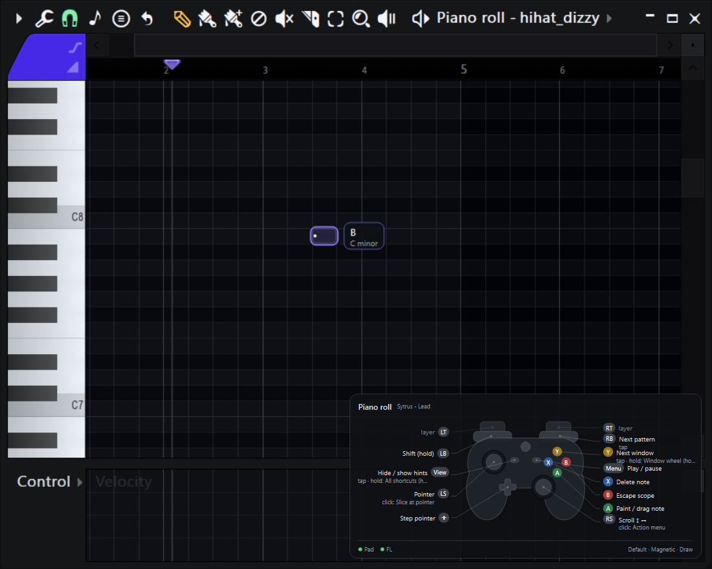

> Windows · FL Studio 2024 (24.x) · Python 3.12+ · not affiliated with Image-Line

## Highlights

- **Magnetic pointer.** Over the Playlist and Piano roll the pointer snaps cell
  by cell with a rumble tick on every step and a highlight that slides like a key
  cap. The grid is *read from FL's pixels*, so it follows your zoom and snap
  without any setup. Notes and clips land exactly on the highlighted cell.
- **Scale lock.** In the Piano roll, up/down moves skip every note outside the
  scale you pick; the chip next to the pointer names the note under it.
- **Tool modes on a layer.** Hold RT to switch FL's draw / paint / delete / mute /
  slice / select tools; the pointer restyles so you always see the active tool.
- **Context-aware layout.** Every FL window (and every plugin, and any other app)
  can have its own bindings; triggers and bumpers are layers, so 15 buttons cover
  far more than 15 actions. Press, release (tap), hold, double-tap, auto-repeat,
  chords and "cheat code" sequences.
- **Always-on HUD.** A list card or a controller diagram shows what each button
  does *right now*, re-labelling itself when you hold a layer.
- **Window wheel, action menus, keyboard.** Hold Y to aim at any open window or
  plugin; R3 opens actions for the current window; L3 types into plugin search.
- **Plugins.** Browse every parameter with live values and adjust it from the
  stick, audition presets, or teach hotspots on any VST UI so the pointer snaps to
  its knobs.
- **Mapping mode.** Sticks, triggers and the DualSense touchpad become MIDI CCs
  (endless "knob" mode included), buttons become notes or channel-rack pads, ready
  for FL's *Link to controller*.
- **Made for old pads.** Per-stick drift calibration, deadzone and response curve,
  with a live plot in the settings window.

## Screenshots

| Controller hint view | …while holding the LT layer |
|---|---|
| 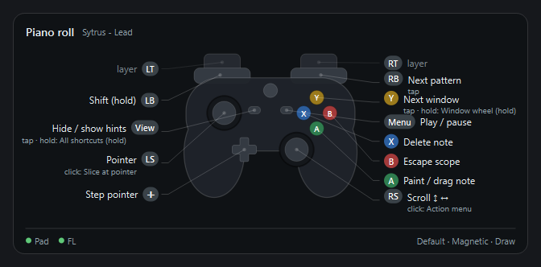 | 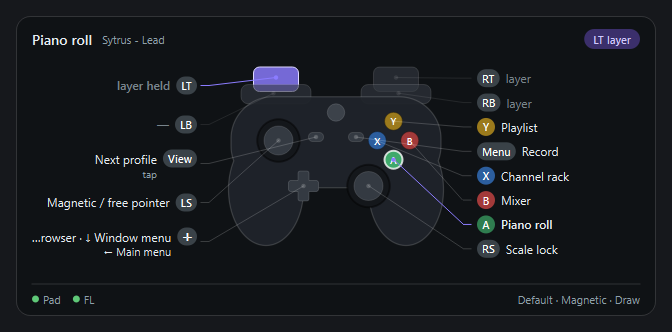 |

| List card | RB layer (Ctrl shortcuts) |
|---|---|
| 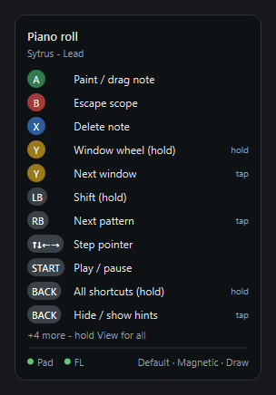 | 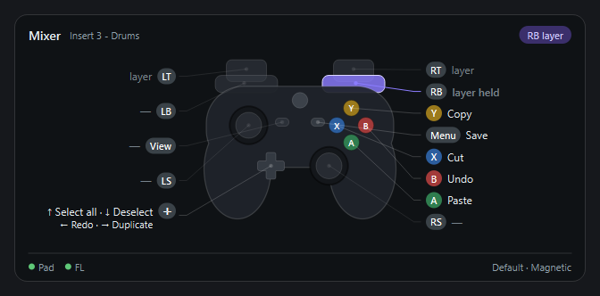 |

**Pointer styles per tool**, plus the press and snap animations:

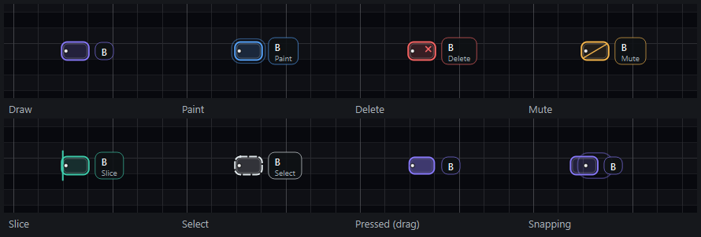

| Window wheel (hold Y) | Action menu (R3) |
|---|---|
| 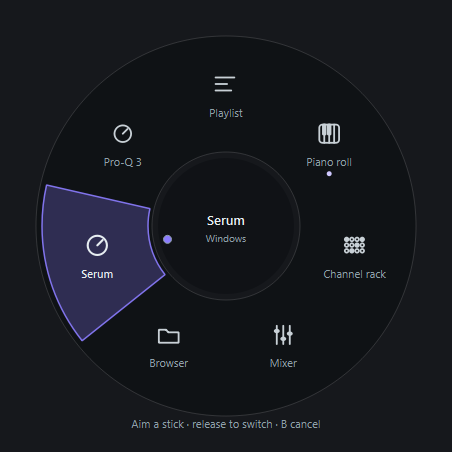 | 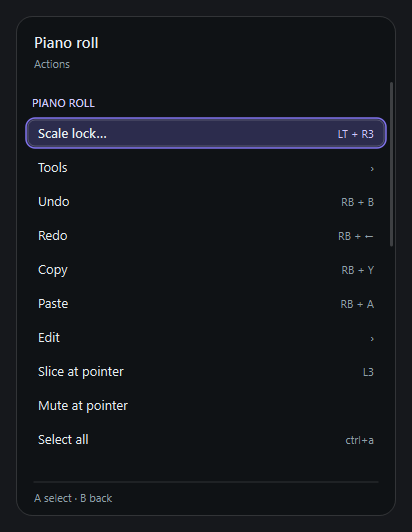 |

| Plugin parameters | On-screen keyboard |
|---|---|
| 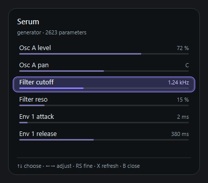 | 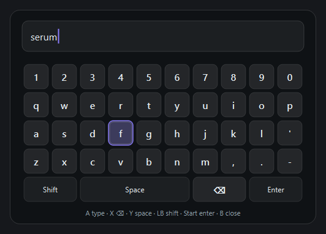 |

**Settings** – live stick plots make drift visible (grey: raw reading, orange:
calibrated deadzone, violet: what EFLC uses):

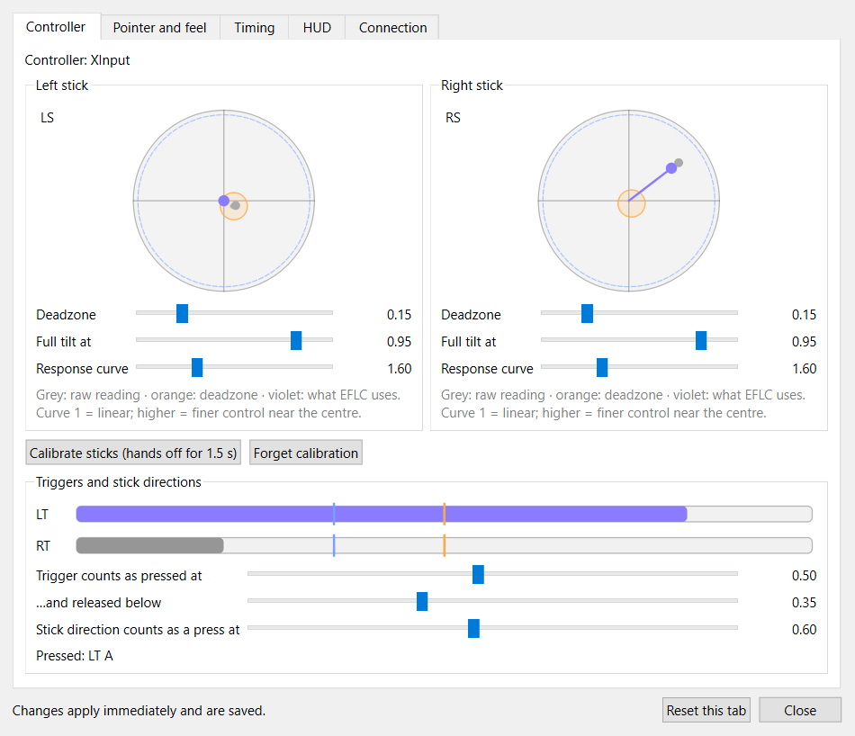

## How it works

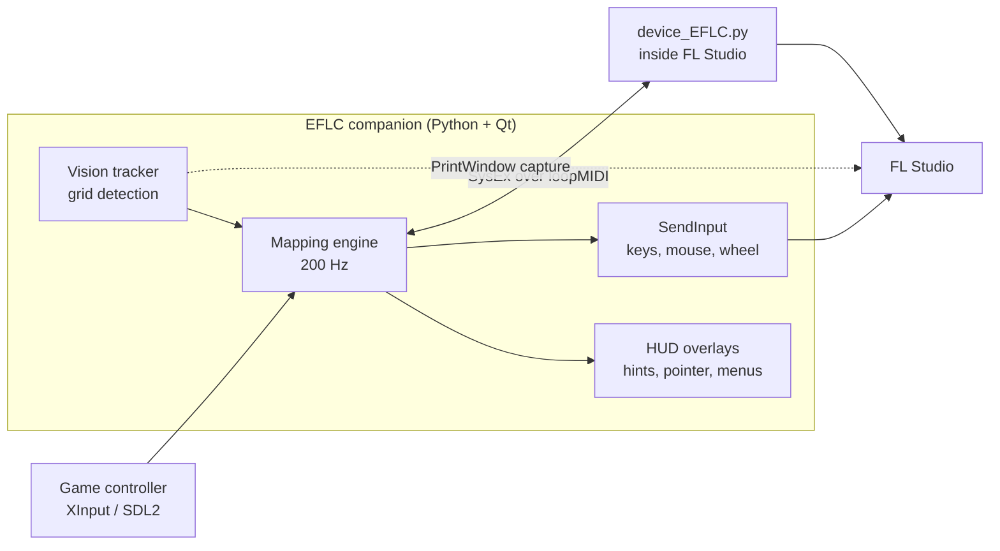

- **The FL link is SysEx, not a socket.** FL's MIDI-script sandbox makes
  `socket()` and `open()` fail, so the companion talks to a script inside FL as
  7-bit JSON over a single loopMIDI port (`F0 7D 45 46 <dir> <json> F7`). The
  script reads FL's state (focused window, plugin, transport, selection) and runs
  a whitelist of actions through FL's official scripting API.
- **The grid comes from pixels.** FL draws its own UI, so the vision tracker
  captures the editor under the pointer with `PrintWindow` (~20 ms, works even
  when covered), finds grid lines against a local median, and fits them as
  *offset + k · spacing* (fractional cell widths like 31.5 px work). Piano roll
  pitch comes from the keyboard strip (black keys are one row tall, the 2-3
  pattern names the notes); Playlist tracks come from the track-header column,
  which clips never cover, so resized tracks work too.
- **Clicks land where you point.** FL snaps a click to the *nearest* grid line,
  so the cursor sits just inside a cell's start line rather than its centre.
- **It feels physical.** Overlays animate on damped springs (implicit
  integration, stable at any frame time), every snap pairs with a short rumble
  pulse, and the real mouse always wins over the pad.

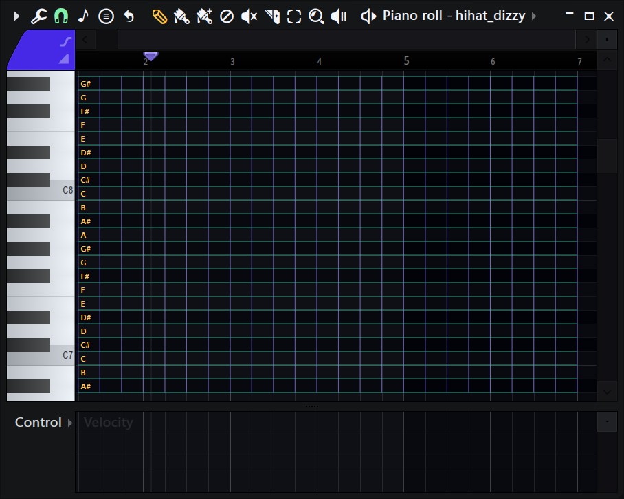

## Setup

1. **loopMIDI** with a port named `EFLC` (Windows 10 has no built-in virtual MIDI).
2. **Bridge script:** `.\install_fl_script.ps1` copies it into FL's user script folder.
3. **FL Studio** *Options › MIDI settings*:
   - Input **EFLC** → *Enable* → *Controller type* **EFLC Bridge** → *Port* **47**
   - Output **EFLC** → *Port* **47** (links them so the script can answer; keep *Send master sync* off)

   *View › Script output* shows `EFLC: bridge v2 loaded…`, then `companion found, link up`.
4. **Companion:**
   ```powershell
   python -m venv .venv
   .\.venv\Scripts\pip install -r requirements.txt
   .\.venv\Scripts\pythonw.exe -m eflc
   ```
   A tray icon appears with the HUD in a corner.
5. **Steam:** disable its *Desktop Layout* (Settings › Controller) or quit Steam,
   otherwise inputs double up. The Xbox **Guide** button opens Game Bar, so it's unbound.
6. **Drift:** tray › *Calibrate sticks*, or **RT + View**, hands off for 1.5 s.

## Default layout (Xbox)

| | Anywhere | In FL Studio |
|---|---|---|
| Left stick / L3 | Pointer / on-screen keyboard | Editors: L3 slices at the pointer |
| Right stick / R3 | Scroll ↕ ↔ (smooth) / **action menu** | RT + RS zoom · LT + RT + both sticks: pinch zoom |
| A / X | Click (hold = drag) / right click | Editors: place · drag / delete |
| B | Esc | Escape current scope |
| Y | | Tap: next window · **hold: window wheel** (aim, release) |
| D-pad | Arrow keys | Navigate · in editors and plugins: step the pointer |
| LB | **Shift** (hold freely) | |
| RB layer | **Ctrl shortcuts:** Y copy · X cut · A paste · B undo · ← redo · ↑ select all · Start save | ↓ deselect · → duplicate · RB tap: next pattern / channel / track / preset · RT + RB: previous |
| LT layer | LT + L3: magnetic / free pointer | A Piano roll · B Mixer · X Channel rack · Y Playlist · ↑ Browser · ↓ window menu · ← main menu · R3 scale lock · Start record |
| RT layer | | ←/→ zoom · ↑/↓ row height · Start stop · **Playlist / Piano roll: tools** A draw · Y paint · B delete · X mute · ↑ slice · ↓ select · ←/→ cycle |
| Start | Enter | Play / pause |
| View | Tap: hints · hold: all shortcuts · LT + View: next profile · RT + View: calibrate | |
| FL menu open | D-pad moves · A chooses · B closes | |

**Action menus** (R3) per window: Piano roll (scale lock, tools, quantize, chop,
strum, arpeggiate, …), Playlist (tools, select, duplicate), Plugin (parameters,
presets, hotspots), Mixer (effects on the track), Channel rack (open plugin).

**Automation profile** (LT + View cycles profiles): sticks are endless MIDI knobs
(CC 21–24, they hold their value when released), triggers CC 25/26, DualSense
touchpad XY CC 29/30, face buttons drum notes, D-pad plays channel-rack channels
1–4. In FL use *Link to controller* on any knob and move the stick.

## Settings and customising

- **Settings window** (tray › *Settings…*, or double-click the tray icon): stick
  shaping and calibration with live plots, trigger thresholds, pointer and scroll
  speed, magnet strength, rumble, hold / double-tap / repeat timing, HUD style,
  corner, size and opacity. Everything applies live and is stored as overrides,
  so bundled profiles keep upgrading.
- **Mapping editor** (tray › *Mapping editor…*): pick a context, *Capture* a
  button combo from the pad, choose what it does, save. Live within a second.
- **Profiles as JSON** in `%APPDATA%\EFLC\profiles`: contexts `plugin:<name>` ›
  `plugin` › window (`pianoroll`, `playlist`, `channelrack`, `mixer`, `browser`)
  › `fl` › `global`, other programs `app:<exe>`, `popup` while an FL menu is open.
  Triggers `press | release | hold | double | repeat`; modifiers `layer` or `key`;
  actions `fl`, `keys`, `text`, `mouse`, `pointer`, `tool`, `tool_mode`, `wheel`,
  `menu`, `keyboard`, `scale`, `profile`, `hud`, `midi`, `pad` and macros; axes
  `pointer`, `scroll`, `hscroll`, `fl_jog`, `midi_cc`, `pinch`; `sequences` for
  cheat codes; `"extends"` to inherit. Edited profiles are never overwritten.
- **Experimental:** `"ui_magnet": true` in `settings.json` extends the magnet to
  FL menus, buttons and other apps (UI Automation). Off by default: FL's menu bar
  isn't covered yet and FL's own hover highlight can disagree with ours.

## Project layout

```
eflc/
  core/       mapping engine, profiles, actions, modals, magnetic pointer, hotspots
  vision/     grid detection (numpy), element detection, background tracker
  input/      XInput + SDL2 backends, stick shaping, drift calibration
  platform/   SendInput, foreground tracking, winmm MIDI, FL window introspection, UIA
  bridge/     SysEx protocol and the companion side of the FL link
  hud/        hint card, controller view, pointer, menus / wheel / keyboard, toasts
  editor/     mapping editor and settings window
  profiles/   bundled profiles: Default, Mixing, Automation
  tools/      padmon (drift check), hud_preview, docs_images (these screenshots)
fl_script/EFLC/device_EFLC.py   runs inside FL Studio
tests/        ~100 tests: engine, pointer, modals, MIDI, settings, grid and element
              detection on real (redacted) FL captures, the FL bridge end to end
```

## Development

```powershell
.\.venv\Scripts\python.exe -m unittest discover -s tests -t .
.\.venv\Scripts\python.exe -m eflc.tools.docs_images          # regenerate docs/images
.\.venv\Scripts\python.exe -m eflc.tools.padmon               # raw vs. processed stick values
```

## Status

Working day to day on Windows 10 with FL Studio 2024 and an Xbox One pad. Not
yet packaged as an `.exe`. Known gaps: FL's preset API can only step (no jump),
Sampler channels aren't "plugins" to FL's API, and the UI-wide magnet stays
experimental.

## License

[MIT](LICENSE) © 2026 violinwav

FL Studio is a trademark of Image-Line. EFLC is an independent project and is
not affiliated with or endorsed by Image-Line.
